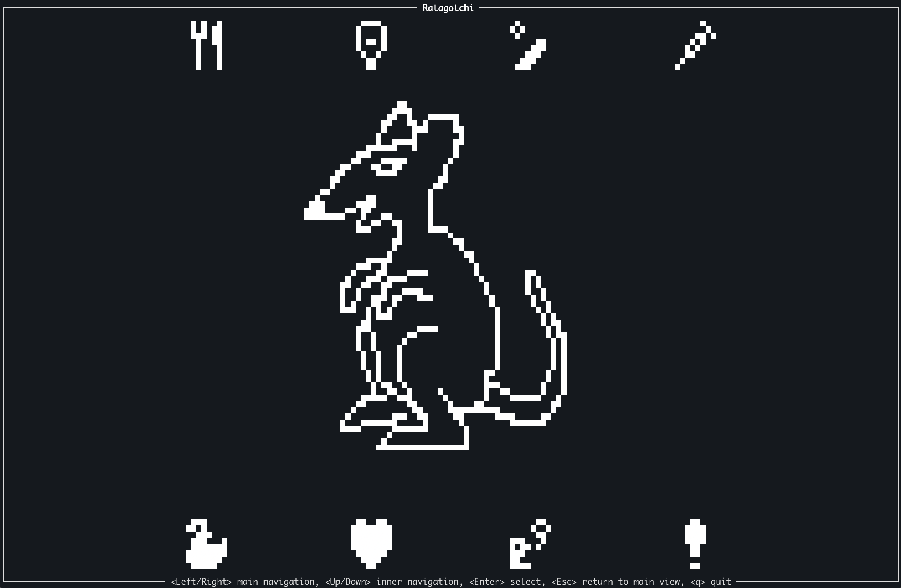

# Ratagotchi

Take care of a cute rat living in your terminal! Feed it, play with it and take care of it.

Written in _Rust_ 🦀 and powered by _Ratatui_ 🐀!

## How to Play

On first load, a new ratagotchi is spawned. From that moment, you need to take care of it so it can grow healthy. Vitals will decay over time, even when the game is not running.

## Features

Different ways to take care of your ratagotchi:

- **Feed**: offer either cheese (tastier but fattening) or premium ratfood (more filling, less rewarding)!
- **Play**: let the ratagotchi pick a number, then guess if the second one is going to be higher or lower than it.
- **Heal**: if your ratagotchi is feeling dizzy, it probably needs some care.
- **Bath**: ratagotchis tend to poop, keep the room tidy.
- **Scold**: it's very important to keep your ratagotchi well disciplined.

## Installation

Right now, you just have to clone the repo and build the project on your local. Binaries coming soon!

## ToDo

There's a bunch of stuff still missing, here's a definitely-not-exhaustive list of features I'd like to implement

### Gameplay

- [ ] Death conditions.
- [ ] "Win" conditions.
- [ ] Day/night cycle, sleep.
    - [ ] Light and ratagotchi reaction.
- [ ] Review all decay factors.
- [ ] Something related to low discipline.
- [ ] Actually implement dynamic bonus/malus multipliers.

### UI

- [ ] Redefine layouts to keep positioning of all elements consistent.
- [ ] Improve navigation button (maybe more square-y).
- [ ] Better bath "wave" (looks like a meatgrinder atm).
- [ ] Low health/disease cue.
- [x] ~~Play view:~~
    - [x] ~~Lock choice once the second number is displayed.~~
    - [x] ~~At the end of the final round, remove the frame still in Play view.~~
- [ ] Visual ratagotchi variants based on its weight.
- [ ] Hall of fame or cemetery for past ratagotchis.

### Misc

- [ ] Setup build jobs for releases.
- [ ] Web build.

## Roadmap

Based on the above list of features, I came up with some sort of "road to 1.0.0". 

- [ ] **0.1.0** Going public with barebone release binaries.
- [ ] **0.2.0** UI rework: layouts refactoring and square-ish navigation buttons (UI).
- [ ] **0.3.0** Better bath animation and low health indicator (UI).
- [ ] **0.4.0** Visual variants based on weight (UI).
- [ ] **0.5.0** Discipline consequences (Gameplay).
- [ ] **0.6.0** Day/night cycle (UI/Gameplay).
- [ ] **0.7.0** Decay factors review (Gameplay).
- [ ] **0.8.0** Bonus/malus system (Gameplay).
- [ ] **0.9.0** Win conditions (Gameplay).
- [ ] **1.0.0** Death conditions (Gameplay).

## Disclaimer

This project is mostly an excuse to learn and write some Rust, so it is very likely littered with unhortodox code and bad decisions. I encourage you to suggest changes in order to improve the code and expand my knowledge.